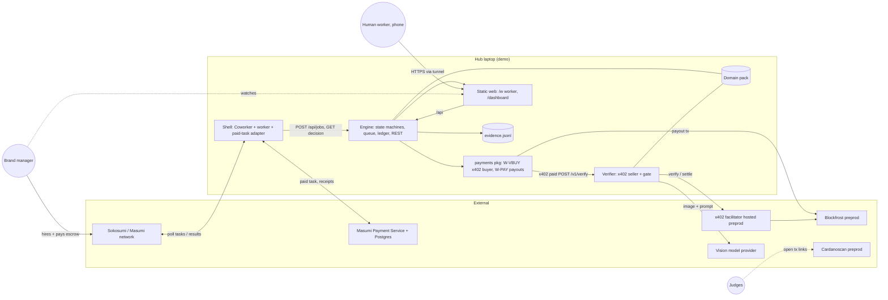
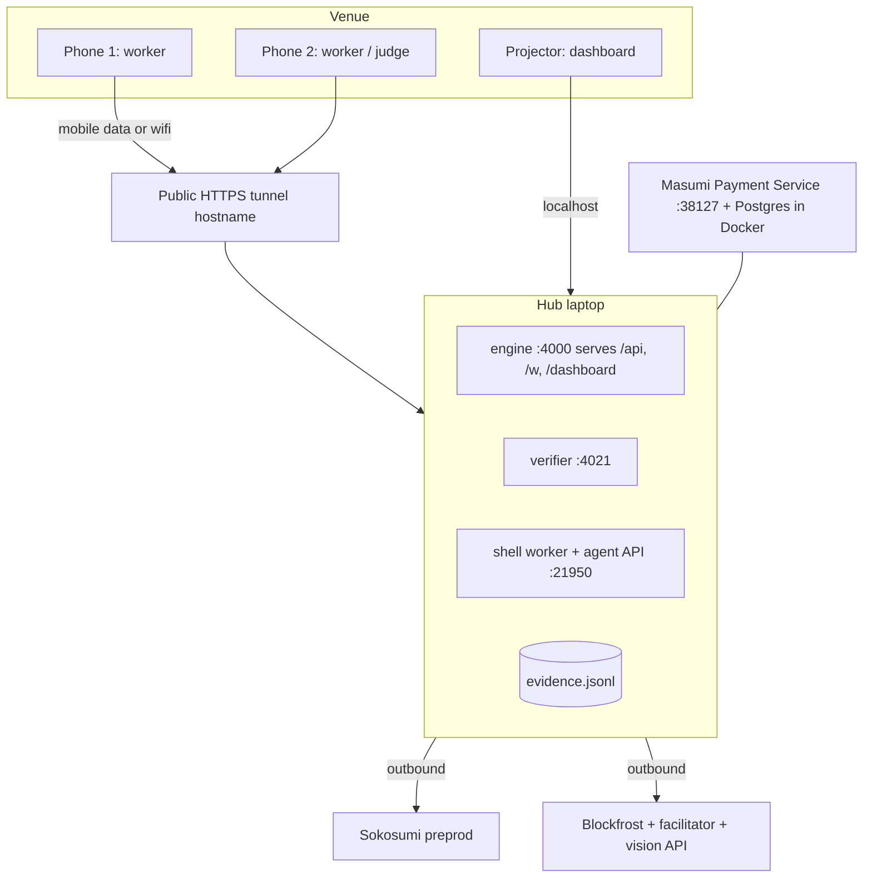

# Architecture

## 1. Principle

A generic **verified micro-task engine**: `Job -> Tasks -> Worker (human | agent) -> Verifier (rules) -> Settlement`. Everything shelf-specific lives in a **domain pack**. Payments, agent shell, state machines, evidence ledger and the UI frame never mention shelves.

## 2. Components

| # | Component | Process | Responsibility | Talks to |
|---|---|---|---|---|
| 1 | **Lead agent shell** | `apps/shell` (Node 24, JS, fork of `tum-hackathon-quickstart`) | Sokosumi Coworker + worker polling, Masumi paid-task adapter (escrow, result hash, receipts). Thin: turns a Sokosumi task into an engine job, waits for the engine decision, then delivers the report or withholds it. | Sokosumi (outbound), Masumi Payment Service, engine |
| 2 | **Engine** | `apps/engine` (TypeScript) | Job/Task/Claim/Submission state machines, intake filter (catalog allowlist, backstop for the catalog-only dropdowns), catalog endpoint, task feed (SSE) with first-claim-wins dispatch, challenge codes, soft city check at claim, capture-time geofence precheck (before any x402 fee), job decision (K rule, N=1 in the MVP), orchestration of verifier calls and payouts, REST API, serves static web, evidence ledger writer. Loads one domain pack. | verifier (x402), payments package, web (static), shell |
| 3 | **Verifier service** | `apps/verifier` (TypeScript, fork of `x402-express` seller) | Sells `POST /v1/verify` behind x402 seller middleware. Runs vision extraction, then deterministic gate rules from the pack. Stateless except an idempotency cache. | vision provider, facilitator (hosted) |
| 4 | **Payout module** | `packages/payments` (library used by engine) | Wallet signers, x402 buyer (`fetchWithPayment` with spend cap) for `W-VBUY`, plain-transfer payouts from `W-PAY`, a per-wallet serial queue, write-ahead log, on-chain reconcile. | Blockfrost, facilitator |
| 5 | **Worker page** | `apps/web` route `/w` (mobile, React) | Wallet sign-in, live task feed for the worker's city (a task disappears when another worker claims it), claim (shows the challenge code), capture with the live camera only (`getUserMedia`, no gallery), location sent with the photo, secondary action "Product not on the shelf", show verdict and payout tx link. | engine API |
| 6 | **Brand dashboard** | `apps/web` route `/dashboard` | Request form (city, store, product dropdowns from the catalogs), job progress per store, verdict with highlighted extraction, out-of-stock results, payments ledger with explorer links, escrow status, demo-override badge. Big-screen layout for the stage. | engine API (poll + SSE) |
| 7 | **Evidence ledger** | `packages/evidence` (JSONL file, hash-chained) | Append-only record of every tx hash, verdict, state change, override. Source for the dashboard ledger, the Devfolio text and the evidence folder. | written by engine |
| 8 | **Domain pack** | `packages/domain-shelf` (and `domain-letter` for Plan B) | Task template, challenge config, extraction prompt and schema, gate rules and thresholds, payout amount, K rule (default k = n = 1), intake catalogs (stores, products), report template, UI labels. | imported by engine and verifier |

The shell stays JavaScript because it is a fork of the starter; it contains no business logic beyond one bridge file (see contracts.md section 1.6). All logic is in TypeScript packages that can be tested without Sokosumi.



## 3. Domain pack and Plan B

The engine calls the pack through one interface (sketch, illustrative only):

```ts
interface DomainPack {
  id: string;                       // "shelf-check" | "letter-decoder"
  version: string;
  jobInput: JsonSchema;             // what the brand/shell sends
  planTasks(input: unknown): TaskSpec[];          // one TaskSpec per unit of work
  worker: WorkerSpec;               // kind: "human" | "agent", capture mode, instructions, challenge config
  extraction: { prompt: string; outputSchema: JsonSchema; imageRequired: boolean };
  rules: GateRule[];                // ordered, deterministic, each returns pass/fail + reason code
  payout: { amountLovelace: string; perTask: boolean };
  settlement: { rule: "k-of-n"; k: number | "n" };   // MVP default: k = n = 1
  report: { columns: Column[]; render(results: TaskResult[]): string };  // markdown for Sokosumi
  ui: UiLabels;                     // titles, button text, card fields for /w and /dashboard
}
```

What is generic (never edited when swapping packs): shell, payout queue, x402 buyer/seller wrappers, state machines, ledger, REST API shape, web frame (task list, claim, capture-or-input step, verdict view, ledger, job table). What is pack-specific: the six fields above. The web frame renders cards and columns from `ui` and `report.columns`.

### Plan B: letter decoder as a second pack

Idea (from decision.md): a resident uploads a German official letter; an OCR worker extracts deadline, amount, authority; rules check plausibility; the report explains the letter.

| Pack field | `shelf-check` | `letter-decoder` (Plan B) |
|---|---|---|
| `jobInput` | `productEan` and one `storeId` chosen from the seeded catalogs (no free text; `stores[]` max 1 in MVP), K (default 1) | letter image(s), language |
| `planTasks` | one task for the single store (one per store when multi-store returns) | one task per page/field group |
| `worker` | `human`, camera capture, challenge code | `agent` (OCR adapter, no phone), no challenge, `capture: "none"` or `"document"` |
| `extraction` | product name, price, code; for an out-of-stock photo: shelf-label text/EAN, facing empty, code | sender, date, amount, reference, deadline |
| `rules` | code, readable, match, price sanity, timing; out-of-stock set: label visible, label match, slot empty | date parses and is plausible, amount parses, IBAN/reference format, sender is non-empty |
| `payout` | bounty to the human | optional fee to the OCR agent address, or `0` (then the payout queue stays idle) |
| `settlement` | K of N, MVP N=1, K=1 (ADR-16) | all fields required (k = n) |
| `report.render` | store table + price range | plain-language summary + deadline table |

Zero-change claim, made precise: swapping the pack touches only `packages/domain-*` and the pack id in config (`PACK_ID`). The shell, `packages/payments`, `apps/engine` core, `apps/verifier` wrapper (x402 middleware, idempotency cache), `packages/evidence` and the web frame are unchanged. Two things the engine must support from day one so Plan B is truly free: (a) `WorkerAdapter` with kinds `human` (waits for a phone submission) and `agent` (engine calls an in-process function that returns the evidence); (b) an optional challenge (`challenge: null`). Both are in the domain model.

## 4. Deployment for the demo

Decision (ADR-06): **tunnel as primary, LAN as fallback**.



- **One hub laptop** runs everything during the demo (engine, verifier, shell, MPS, Postgres). Reason: one machine to keep awake, no cross-laptop URLs, one `.env` set. During development each person runs their own component on localhost against the fakes and stubs (repo-layout.md section 4).
- **One tunnel** exposes only the engine port (it serves API and both pages). The verifier and MPS are never public. Tunnel tool: Cloudflare quick tunnel (`cloudflared tunnel --url http://localhost:4000`), no account needed (verify Friday); alternatives: ngrok, Tailscale Funnel. Reason for tunnel over LAN: phone browsers allow `getUserMedia` (in-app camera, no gallery pick) only in secure contexts, and conference Wi-Fi often isolates clients. The tunnel gives HTTPS and works on mobile data.
- **LAN fallback (read-only, ADR-17)**: laptop hotspot or venue Wi-Fi, page at `http://<lan-ip>:4000/w`. HTTP cannot use `getUserMedia` and Shelfie does not fall back to `<input type=file capture>` (it can open the gallery on some phones), so over HTTP the worker page can show the feed and task detail but **cannot take or submit a photo**; the engine also rejects any submission whose `captureMode` is not `getUserMedia`. To get a secure context without the public tunnel: (1) HTTPS on the LAN with a locally trusted certificate (mkcert root installed on the phones; verify Friday that iOS Safari and Android Chrome then allow the camera); (2) a second tunnel provider as spare; (3) Android only: USB with `adb reverse tcp:4000 tcp:4000` and open `http://localhost:4000/w` (localhost is a secure context). The page detects `window.isSecureContext` and shows the read-only notice automatically. Verify Friday which of these works at the venue; if none does, phones must use the tunnel on mobile data.
- **Public URL stability**: quick-tunnel hostnames change on restart. The hub script prints the URL and renders a QR code for `/w` on the dashboard. Re-scan after a restart; never restart the tunnel mid-demo.
- **Shell and Masumi**: the worker polls Sokosumi outbound, so it needs no inbound reachability; whether the paid-task agent API's loopback URL must be public is an open question for the Masumi 1:1 (verify Friday).
- **Secrets**: only env files, never in the repo, throwaway wallets only (x402 runbook pitfall).
- **Sleep**: hub laptop on mains power, sleep and screen lock disabled; one worker process only.

## 5. Sequence diagrams

### 5.1 Happy path

```mermaid
sequenceDiagram
  autonumber
  actor Brand
  participant SOK as Sokosumi/Masumi
  participant SH as Shell
  participant EN as Engine
  participant W as Worker page (phone)
  participant PAYQ as Payout queue (W-PAY)
  participant VB as Verify client (W-VBUY)
  participant VE as Verifier
  participant FAC as Facilitator
  participant CH as Cardano preprod
  Brand->>SOK: Hire Shelfie (product, one Munich store), fee locked in escrow
  SOK->>CH: escrow lock tx (tx_lock)
  SH->>SOK: poll, receive paid task
  SH->>EN: POST /api/jobs (idempotencyKey = sokosumi task id)
  EN->>EN: intake filter (store and product in catalogs, city Munich)
  EN->>EN: pack.planTasks -> 1 task OPEN
  EN-->>W: SSE task_opened to all workers in Munich (feed)
  W->>EN: POST /api/tasks/{id}/claim (+ coarse browser location), first claim wins
  EN->>EN: soft check: worker city == store city; atomic OPEN -> CLAIMED
  EN-->>W: challengeCode, expiresAt (other workers get task_closed, task leaves their feed)
  Note over W: Worker writes/holds code next to price tag, shoots with the live camera (no gallery)
  W->>EN: POST /api/tasks/{id}/submissions (image + location at capture)
  EN->>EN: precheck: distance to store <= geofence radius (+ accuracy); fail = 422, no fee, claim stays
  EN->>VB: verify(submission) with idempotency key
  VB->>VE: POST /v1/verify (no payment)
  VE-->>VB: 402 + PAYMENT-REQUIRED (1 tADA)
  VB->>VB: sign tx (spend cap) with W-VBUY
  VB->>VE: retry with PAYMENT-SIGNATURE
  VE->>FAC: verify payment
  VE->>VE: vision extraction + gate rules
  VE->>FAC: settle
  FAC->>CH: x402 payment tx (tx_verify)
  VE-->>VB: 200 verdict PASS + PAYMENT-RESPONSE receipt
  VB-->>EN: verdict + tx_verify
  EN->>PAYQ: enqueue payout (key payout:taskId)
  PAYQ->>CH: transfer to worker address (tx_payout)
  EN-->>W: verdict PASS, payout tx link
  EN->>EN: photo PASS (1 of 1) -> job decision PASS, render report
  SH->>EN: GET /api/jobs/{id}/decision (long poll)
  EN-->>SH: PASS + report markdown
  SH->>SOK: submit result hash + report
  SOK->>CH: settlement after unlock window (tx_settle)
```

### 5.2 Rejected photo

```mermaid
sequenceDiagram
  autonumber
  participant W as Worker page
  participant EN as Engine
  participant VB as Verify client
  participant VE as Verifier
  participant L as Ledger
  W->>EN: POST submission (old camera-roll photo, wrong/missing code)
  EN->>VB: verify(submission)
  VB->>VE: x402 paid POST /v1/verify
  VE->>VE: extraction; gate G2 code_match fails
  VE-->>VB: 200 verdict FAIL [code_mismatch] + receipt
  VB-->>EN: verdict FAIL, tx_verify
  EN->>L: append verdict + tx_verify (the check was paid, the photo was not)
  Note over EN: no payout enqueued, task attempt REJECTED
  EN->>EN: attempts < max -> task back to OPEN (new attempt needs new code)
  EN-->>W: FAIL, reason in plain words, button "try again"
```

The verifier fee is paid for a rejected photo too (the verifier is paid per check). This is a stated cost of the model; the dashboard shows it as "verification spend".

### 5.3 No passing photo, withheld result, refund (single-photo job)

```mermaid
sequenceDiagram
  autonumber
  actor Brand
  participant SOK as Sokosumi/Masumi
  participant SH as Shell
  participant EN as Engine
  participant CH as Cardano preprod
  Brand->>SOK: Hire Shelfie (1 store, 1 product), escrow locked
  SH->>EN: POST /api/jobs
  Note over EN: every attempt is REJECTED (or nobody claims) until max attempts or the window closes
  EN->>EN: window closed -> passed 0 < K 1 -> decision FAIL
  EN->>EN: ledger: JOB_WITHHELD (reason no_passing_photo)
  SH->>EN: GET decision
  EN-->>SH: FAIL (no report)
  SH->>SH: persist quality-failed, do NOT submit hash or COMPLETE
  Note over SH,SOK: a submitted hash, even "failed", would pay the seller
  SOK-->>CH: no result by submit deadline + about 10 min -> buyer auto-refund (tx_refund)
  Brand-->>SOK: sees refund
  Note over EN: no worker was paid (pay only on PASS, and PASS delivers the job); Shelfie bears only the verifier fees of the rejected attempts
```

Remaining loss in this path (ADR-16): one verifier fee (1 tADA) per rejected attempt, up to `MAX_ATTEMPTS` (default 3), plus the wait for the refund. No worker is paid, because a worker is paid only on PASS and with N=1 a PASS always delivers the job. The same withhold path serves an intake rejection (contracts.md section 1.1a), with no attempts at all.

Timing consistency: the task window (`JOB_WINDOW_SEC`) closes at least 8 minutes before the Masumi submit deadline, and no new claim starts after `windowEndsAt - CLAIM_TTL_SEC - VERIFY_BUDGET_SEC` (contracts.md section 1.6), so every accepted photo is verified, paid and the report is submitted before the deadline. Retries (new challenge code each) happen inside the window.

Timing (from the Masumi runbook, estimates): refund eligibility roughly 30 min after the submit deadline, payout roughly 46 min after submission. Record the refund run Friday and show its explorer link on Saturday; do not wait for it live.

### 5.4 Intake rejection (before any task exists)

`POST /api/jobs` validates the job against the seeded catalogs (known Munich store, known product, city Munich). On failure the engine returns 422 `intake_rejected` with reasons and the id of the job, now stored as `REJECTED_INPUT`, creates no task and pays no one. If the Sokosumi task was already escrowed, the shell submits no hash, comments the reasons on the task and the buyer auto-refunds (ADR-11). Verify Friday whether the task can instead be declined before escrow locks.

### 5.5 Product not on the shelf (out of stock)

```mermaid
sequenceDiagram
  autonumber
  participant W as Worker page
  participant EN as Engine
  participant VB as Verify client
  participant VE as Verifier
  participant PAYQ as Payout queue
  W->>EN: claim (same as 5.1), code shown
  Note over W: Worker taps "Product not on the shelf", photographs the empty spot: shelf-edge label readable, facing empty, code in frame
  W->>EN: POST submission (outcome OUT_OF_STOCK, image, location)
  EN->>EN: location precheck (same as price photo)
  EN->>VB: verify(outcome OUT_OF_STOCK)
  VB->>VE: x402 paid POST /v1/verify
  VE->>VE: vision reads label, facing, code; gates G1 G2 O3 O4 O5 G6 G7
  VE-->>VB: verdict outcome OUT_OF_STOCK, pass + receipt
  EN->>PAYQ: enqueue payout (same amount and key as a price photo)
  EN->>EN: observation accepted -> job DELIVER, report "out of stock at store X, time T"
```

The escrow settles as for a price photo: the brand paid for an observation of the shelf, and "not there" is one. The task has two accepted outcomes (`OBSERVED`, `OUT_OF_STOCK`); the Job decision counts either toward K. The report names the outcome and the evidence, and says what was seen at the shelf spot, not why (delisted, sold out, misplaced).

## 6. Failure containment

| Failure | Containment |
|---|---|
| Vision provider down or slow | Verifier returns `503 vision_unavailable` before x402 settle where possible (free); engine retries the same idempotency key. If it keeps failing: stage fallback is the demo override (verifier-rules.md section 8), flagged. |
| Facilitator unreachable | Seller returns 500 "no supported payment kinds"; engine marks submission `VERIFY_RETRY`, retries with backoff. Fallback: local facilitator (`npm run facilitator` in the template). |
| Payout wallet out of funds | Dashboard banner from `GET /api/health` (balance check); payouts stay `QUEUED`, never dropped. |
| Tunnel dies | Phones lose the page; claims keep their TTL; restart the tunnel on the same engine; LAN is read-only unless a secure LAN option (section 4) works. |
| Engine restart | State reloaded from the append-only store; payouts in `SENDING` are reconciled on-chain before any retry (domain-model section 6). |
| Masumi escrow not working by the go/no-go | Freeze M4/M5; demo runs the engine with the dashboard-created job (flagged "demo job, no escrow") and shows recorded escrow evidence if any. |
