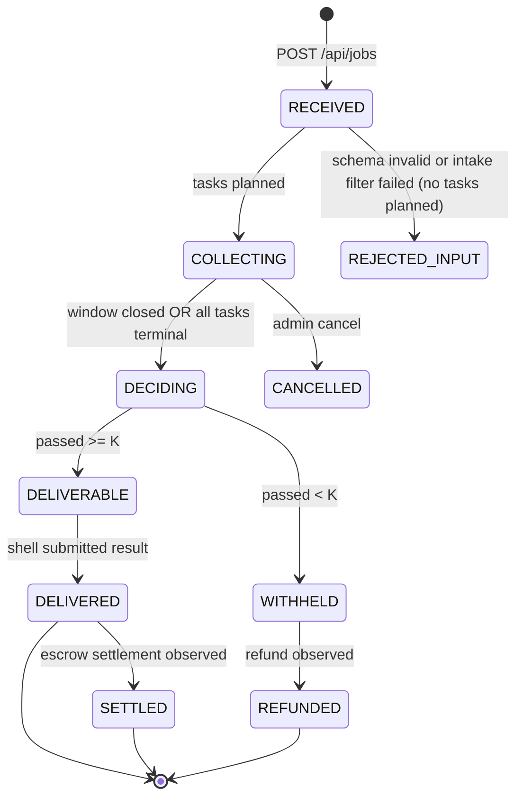
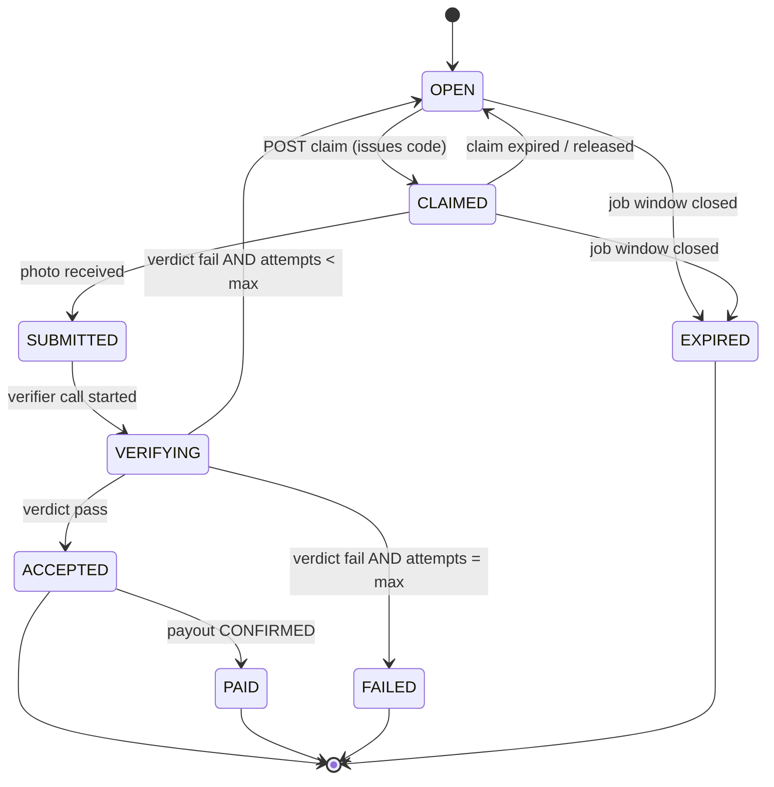
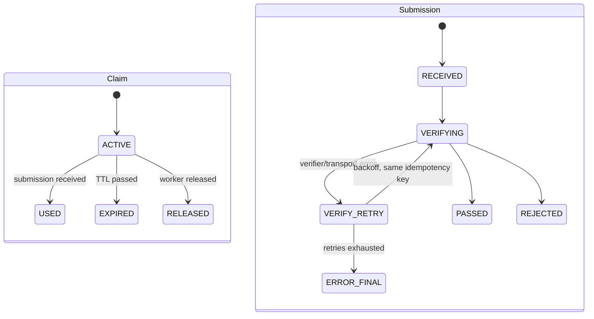
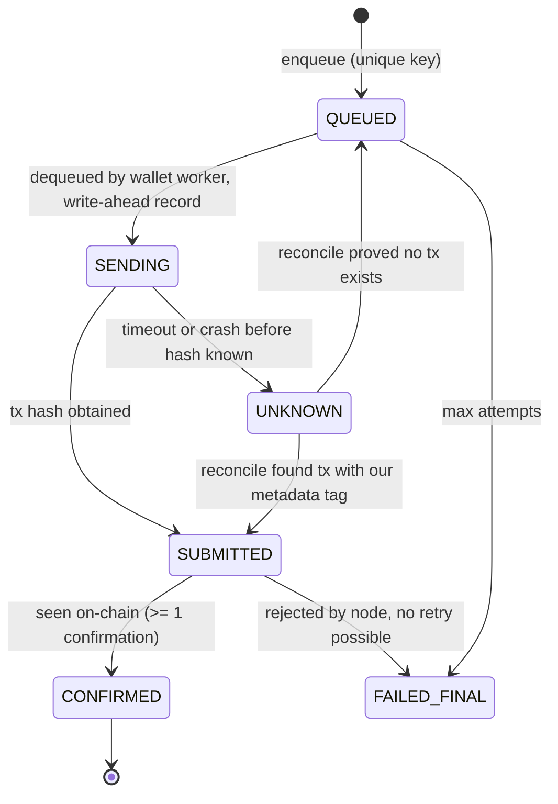

# Domain model

All entities live in `packages/core` as TypeScript types plus zod schemas (validated at every HTTP boundary). Persistence: an in-memory map per entity with an append-only event log on disk (`engine-events.jsonl`) replayed at start; behind a `Store` interface so SQLite can replace it if time allows (ADR-10). Money is a decimal string of lovelace.

## 1. Entities

| Entity | Key fields (illustrative) | Notes |
|---|---|---|
| **Job** | `id`, `packId`, `input` (pack schema), `source` (`shell` or `demo`), `externalRef` (Sokosumi task id, Masumi identifiers), `k`, `n`, `windowEndsAt`, `state`, `decision`, `reportMd`, `createdAt` | One hired engagement. MVP: `n = 1`, `k = 1` (one store, one photo; ADR-16); the fields stay so multi-store returns without a schema change. `externalRef` is the idempotency anchor for creation. |
| **Task** | `id`, `jobId`, `spec` (pack-defined, e.g. store + product), `state`, `attempts`, `maxAttempts`, `currentClaimId`, `acceptedSubmissionId`, `payoutAmount` | One unit of work (one store). MVP: exactly one Task per Job. `spec` holds `storeId` and `productEan` (ids from the catalogs, ADR-17); names, aliases, address, coordinates and `geofenceRadiusM` are looked up from the catalog. `acceptedOutcome` is `OBSERVED` or `OUT_OF_STOCK` once ACCEPTED. The task is visible to every worker in the job's city while OPEN (dispatch, section 2.2). |
| **ChallengeCode** | `code`, `claimId`, `issuedAt`, `expiresAt`, `usedBySubmissionId` | Alphabet without confusable characters, 6 chars shown as `ABC-123`. Single use. A new claim attempt gets a new code. Optional `cardPoolId` when the pack uses printed cards. |
| **Claim** | `id`, `taskId`, `workerId`, `payoutAddress`, `challengeCode`, `expiresAt`, `state` | Worker reserves a task for a TTL. Creating a claim needs the soft city check (`locationSource`, `cityMatch`; coarse, spoofable, not stored beyond that). First claim wins: the OPEN -> CLAIMED transition is a single atomic step in the engine. `locationTries` counts failed capture-time location prechecks (max `LOCATION_MAX_TRIES`). |
| **Submission** | `id`, `claimId`, `taskId`, `receivedAt` (server clock), `imageSha256`, `imageRef`, `clientMeta` (user agent, capture mode), `verifyIdempotencyKey`, `state` | One photo upload. `outcome` is the worker's claim, `OBSERVED` (price tag) or `OUT_OF_STOCK` (empty shelf spot); `clientMeta.captureMode` must be `getUserMedia` (ADR-17); `captureLocation` keeps only `distanceM`, `accuracyM`, `withinGeofence` (raw coordinates are not stored). |
| **Verdict** | `id`, `submissionId`, `pass`, `gates[]` (name, pass, reasonCode, detail), `extraction` (raw model JSON), `outcome` (what was judged), `verifierTx` (x402 tx hash), `source` (`GATE` or `MANUAL_OVERRIDE`), `overrideReason`, `modelId`, `latencyMs` | Immutable once written; an override creates a new Verdict that supersedes. |
| **Payout** | `id`, `taskId`, `idempotencyKey` (`payout:<taskId>`), `toAddress`, `amount`, `state`, `txHash`, `metadataTag`, `attempts`, `lastError`, `walletId` | One per task, enforced by a unique key. |
| **Settlement** | `id`, `jobId`, `decision` (`DELIVER` or `WITHHOLD`), `passed`, `k`, `n`, `resultHash`, `shellAction` (`RESULT_SUBMITTED` or `WITHHELD`), `escrowRefs` (lock, settle, refund tx hashes when known), `state` | The job-level outcome. Escrow facts are recorded, not controlled, by the engine. |
| **EvidenceEntry** | `seq`, `ts`, `kind`, `refs` (ids), `txHash?`, `explorerUrl?`, `payloadHash`, `prevHash`, `note`, `flags` (e.g. `demoOverride`) | Hash-chained, append-only, one line of JSONL. |

## 2. State machines

### 2.1 Job

- Intake filter (contracts.md section 1.1a) runs in `RECEIVED`: store and product must be in the seeded catalogs and the city must be Munich, otherwise `REJECTED_INPUT` with reason codes and no tasks. The shell then withholds the escrowed task (no worker involved).
- MVP: `n = 1`, `k = 1`, so `passed >= K` means "the one photo passed"; the window closes before the Masumi submit deadline (contracts.md section 1.6).
- `DECIDING` can also trigger early: as soon as `passed >= K` and the pack sets `earlyDeliver: true`; default is wait for window end or all tasks terminal (so the dashboard shows the full table).
- `SETTLED` and `REFUNDED` are informational. They are set when the shell reports the Masumi event or when an operator records the explorer link in the ledger. The engine never blocks on them.

### 2.2 Task

**Dispatch (ADR-17).** An OPEN task is pushed to every worker whose coarse location is in the task's city (SSE `task_opened`; polling fallback). `claim` is an atomic compare-and-set: the first request wins and the engine emits `task_closed` so other feeds drop the task; a late claim gets 409 `task_not_open`. A worker holds at most one active claim. A claim that expires or is released returns the task to OPEN and re-emits `task_opened`.

`ACCEPTED` (either outcome, `OBSERVED` or `OUT_OF_STOCK`) counts toward K immediately (with K=1 it is the job outcome) (payout may still be in flight). A task in `ACCEPTED` with a failed payout stays `ACCEPTED`; the payout has its own machine.

### 2.3 Claim and Submission (attempt level)

A claim is single-use: one verified submission per claim. A submission that fails the engine's location precheck is not verified, creates no Submission record and does not burn the code or an attempt (the claim stays ACTIVE until its TTL or `LOCATION_MAX_TRIES` failures, then it is released); it is written to the ledger as `LOCATION_CHECKED`. A rejected submission burns its code; retry means a new claim and a new code (and a new location check). No claim is issued after the claim cutoff `windowEndsAt - CLAIM_TTL_SEC - VERIFY_BUDGET_SEC`. `ERROR_FINAL` leaves the task in `OPEN` and raises an operator alert (it is not a worker fault, so the attempt is not counted).

### 2.4 Payout

Hard rule: **no transition `UNKNOWN -> QUEUED` without a successful reconcile that proves the transfer does not exist.** This is the double-payment guard.

### 2.5 Settlement

`PENDING -> WITHHOLD | DELIVER`, then `DELIVER -> RESULT_SUBMITTED -> SETTLED` or `WITHHOLD -> WITHHELD -> REFUNDED`. The shell posts its observations to `POST /api/jobs/{id}/settlement-events`; the engine only stores them.

## 3. Idempotency keys

| Operation | Key | Where enforced | Behaviour on repeat |
|---|---|---|---|
| Create job | `externalRef` (Sokosumi task id) or client-supplied `Idempotency-Key` header for demo jobs | engine job store, unique index | Return the existing job (HTTP 200, same body). |
| Claim a task | `(taskId, workerId)` while a claim is `ACTIVE` | engine | Return the existing claim and the same code. |
| Submit a photo | `claimId` (one submission per claim) plus `imageSha256` | engine | Same claim: return the existing submission. Same hash on another claim of the same job: reject `duplicate_image`. |
| Verify | `verify:<submissionId>` sent as `Idempotency-Key` to the verifier | verifier cache (in-memory plus file, TTL longer than the job window) | Verifier returns the cached verdict and does not call the vision model again. The x402 payment is a separate concern (below). |
| x402 payment for a verify | one payment per `verify:<submissionId>`; the client stores `PAYMENT-RESPONSE` receipt per key | payments package | On timeout, do **not** re-sign: first check W-VBUY on-chain history (and the receipt store) for a payment to `W-SELL` made for this key; only if none exists pay again. |
| Payout | `payout:<taskId>` | engine unique index plus payments queue | Second enqueue returns the existing Payout. |
| On-chain payout tx | metadata tag `shelfie:<payoutId>` in the tx metadata | payments reconcile | Lets reconcile find an earlier attempt after a crash or timeout (verify Friday that the SDK can attach metadata; see ADR-04 for the fallback). |
| Shell result submission | `submit:<jobId>` | shell bridge | Shell checks the journal before submitting a hash; Masumi stock behaviour about uncertain `*-pending` writes is preserved (runbook: no auto-retry of uncertain writes). |
| Ledger entry | `(kind, refs)` natural key plus `seq` | evidence package | Writing the same event twice is a no-op. |
| Override | `override:<submissionId>` | engine | One override per submission. |

## 4. Payment topology and the one-wallet-no-concurrency rule

The x402 runbook states: one wallet cannot pay concurrently (the first UTxO is the nonce), and a timeout does not mean the payment failed. Design consequences:

- **Separate wallets by purpose**, each with its own serial queue and its own funds, so a verify payment and a worker payout never compete for UTxOs:
  - `W-VBUY`: engine pays the verifier (x402 buyer, spend cap per payment).
  - `W-PAY`: engine pays workers (plain transfers).
  - `W-SELL`: receives verifier fees. The verifier holds no keys, only the address.
  - `W-MPS`: seller wallet of the Masumi Payment Service (independent).
- **Verify queue**: concurrency 1 on `W-VBUY`. If measured throughput is too low, add `W-VBUY-2` and round-robin (`VBUY_WALLETS` count; names only, ADR-08). Demo volume (about 5 to 10 submissions) fits one wallet; typical x402 latency 20 to 60 s means a burst of 5 uploads takes several minutes serialised, so the worker page shows "queued for verification" with position, and the demo script staggers submissions.
- **Payout queue**: concurrency 1 per payout wallet, FIFO by acceptance time; the next send starts only after the previous tx is `CONFIRMED` or its change output is visible (UTxO safety). Optional `PAYOUT_WALLETS` > 1 gives parallelism by assigning `walletIndex = hash(taskId) mod count`.
- **Funding budget** (inference, tADA): per accepted task about 1 (verify) + 0.17 fee + 3 (payout) + 0.2 fee, per rejected attempt about 1.17. For 10 tasks with 4 rejections: roughly 50 tADA; fund each of `W-VBUY` and `W-PAY` with at least 100 tADA, `W-SELL` needs only to exist.

## 5. Challenge code rules

- Alphabet `ABCDEFGHJKMNPQRSTUVWXYZ23456789` (no `0 O 1 I L`, which are easily confused), 6 characters, displayed `XXX-XXX` in a large mono font. About 30^6 combinations is plenty for a demo; codes are random (CSPRNG), not derived from the task id.
- TTL default 300 s from issue (`CLAIM_TTL_SEC`). Expired claims return the task to `OPEN`.
- Modes: `handwritten` (worker writes the code on paper and holds it beside the tag; default for any worker), `card-pool` (printed cards with pre-generated codes, engine assigns a card number; used for the stage demo for reliability), and `none` (Plan B agent workers). The mode is part of the pack config.
- What it proves: the photo was taken after the claim was issued and for this task. It does **not** prove location (stated limit; roadmap: store-owned QR codes). Two soft browser-geolocation checks add a deterrent: city level at claim, and a geofence distance check at capture (ADR-17); both are spoofable and neither is proof. The code is shown on the phone and copied to paper or a card; with camera-only capture the phone cannot photograph its own screen.

## 6. Payout queue algorithm (spec, no code)

1. `enqueue(taskId)`: insert Payout with unique `payout:<taskId>`; state `QUEUED`; ledger `PAYOUT_QUEUED`.
2. Wallet worker loop (one per wallet): take the oldest `QUEUED`; write-ahead set `SENDING` with `attempts+1` and flush to disk **before** calling the SDK.
3. Build and submit the transfer with metadata `shelfie:<payoutId>`; on hash, set `SUBMITTED`, ledger `PAYOUT_SUBMITTED` with tx hash and explorer URL.
4. Poll confirmation (Blockfrost) every few seconds up to a timeout; on success `CONFIRMED`, ledger `PAYOUT_CONFIRMED`.
5. Any error or timeout between 2 and 3 leaves `SENDING`; on startup and on error the worker moves it to `UNKNOWN` and runs **reconcile**: query recent transactions of `W-PAY` and look for the metadata tag or for an output of the right amount to `toAddress` after the write-ahead timestamp. Found: `SUBMITTED` with that hash. Provably absent after a settling delay of at least two minutes: back to `QUEUED`. Inconclusive: stay `UNKNOWN`, alert the operator, no automatic resend.
6. Node rejection with a clear reason (bad address, insufficient funds): `FAILED_FINAL` after `PAYOUT_MAX_ATTEMPTS`, or immediately for a bad address. Insufficient funds is not final: pause the queue and alert.
7. Operator actions (admin token): `retry` (only from `FAILED_FINAL` or after reconcile), `mark-paid <txHash>` (records an out-of-band payment, flagged in the ledger).

The same loop shape serves the verify queue, except the send step is `fetchWithPayment` and the "tx" is the x402 settlement receipt.

## 7. Invariants (test targets)

1. At most one Payout per Task.
2. A Payout is never created for a Task whose Verdict is not an effective pass (the latest Verdict, an override counts and is flagged).
3. A Submission is verified at most once per idempotency key; the vision model is called at most once per key.
4. A challenge code is accepted only for its own claim, once, within its TTL.
5. Job decision `DELIVER` implies `passed >= K` at decision time; decision never flips after the shell has acted.
6. The shell submits a result hash only after decision `DELIVER`.
7. Every on-chain transaction in the system appears in the ledger with its hash.
8. A task has at most one active claim; two concurrent claims on one task never both succeed.
9. A submission with `captureMode` other than `getUserMedia` is never stored or verified (except the flagged admin test path).
10. A location-precheck failure never causes an x402 payment.
11. An `OUT_OF_STOCK` payout equals the `OBSERVED` payout for the same task, and the report names the outcome.
