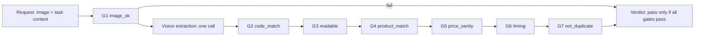

# Verifier rules (shelf-check pack)

Owner: C. The verifier is a **deterministic gate around a probabilistic extractor**. The vision model only reads; every pass/fail decision is made by plain code on its output. This is the lesson from the competitive scan: escrow and payouts need a pass/fail that can be explained, not an opinion about quality.

## 1. Pipeline



- All gates are evaluated and reported (no short circuit after the vision call), so the dashboard and worker message can show every failure. G1 failing skips the vision call (it would waste cost and time).
- `pass = all gates pass`. There is no weighted score deciding the verdict. Scores exist only inside a gate against its own threshold.
- The same code runs for the paid endpoint, the dry endpoint and the evaluation runner (one function `evaluate(task, image, extraction)`; the vision call is the only impure step and is injected, so the rules are unit-testable with fixture JSON and no model).

## 2. Gates (price-photo verdict `OBSERVED`)

This is the gate set for a normal price-tag photo. An out-of-stock photo runs a different set (section 2a). Location is **not** a verifier gate: the engine prechecks it before calling the verifier so a location failure costs no x402 fee (ADR-17, contracts.md section 1.3).

| Gate | Input | Pass condition | Reason codes on failure | Worker message (plain words) |
|---|---|---|---|---|
| **G1 image_ok** | bytes, mime | Decodable JPEG or PNG; width at least 800 and height at least 600 after decode; bytes at most `maxBytes`; not near-uniform (mean pixel variance above a small floor) | `image_undecodable`, `image_too_small`, `image_too_large`, `image_blank` | "The photo could not be used. Take a new one." |
| **G2 code_match** (challenge) | Gesture mode (ADR-19, default): `extraction.gesture` (hand seen: `handVisible`, `fingers`, `side`, `confidence`), `expectedGesture`. Code modes: `extraction.code`, `expectedCode` | Gesture: hand visible, `fingers` equals the issued count (2-5) and `side` equals the issued side (`left`/`right` of the tag, as seen in the photo), confidence at least `minGestureConfidence` (0.7). Code: normalise both (uppercase, strip spaces and the hyphen); pass when edit distance is at most `maxEditDistance` (default 0) **and** the code confidence is at least 0.7 | Gesture: `gesture_missing`, `gesture_mismatch`, `gesture_low_confidence`. Code: `code_missing`, `code_mismatch`, `code_low_confidence` | Gesture: "We could not see {gesture} in your photo. Keep your hand and the tag in frame and try again." Code: "We could not read the code {expected} in your photo. Hold the paper closer and try again." |
| **G8 not_screen** | `extraction.advisory.looksLikeScreenPhoto` | Fails only on an explicit `true` (null or missing pass). Pack param `enabled` (default true) is the kill switch | `screen_recapture` | "This looks like a photo of a screen. Photograph the real shelf." |
| **G3 readable** | `priceText`, `priceValue`, `currency`, `productText`, `confidence` | `priceValue` is a finite number parsed from `priceText` by our parser (not trusted from the model alone); currency is EUR or absent in a German shop; `productText` is non-empty; overall `confidence` at least 0.6 | `price_unreadable`, `product_unreadable`, `low_confidence` | "The price tag is not readable. Move closer and avoid glare." |
| **G4 product_match** | `productText`, `barcodeDigits?`, task product (`name`, `ean`, `aliases`) | If `barcodeDigits` is read with a valid EAN-13 checksum and equals the task EAN: pass (`eanOverrides`). Store-internal barcodes (GS1 restricted-circulation prefixes 020-029, 040-049, 200-299) are ignored, so the name decides. Otherwise token-set similarity between normalised `productText` and name or any alias at least 0.8 (lowercase, strip accents and punctuation, ignore pack-size tokens and stop words) | `product_mismatch`, `ean_mismatch` | "This does not look like {product}. Check that you are at the right product." |
| **G5 price_sanity** | `priceValue`, pack bounds, optional job reference price | `minEur <= price <= maxEur` (defaults 0.20 and 60.00; the engine passes the product's `priceMinEur`/`priceMaxEur` from the seeded catalog, contracts.md section 1.1a); if the job gives a reference price, `abs(price - ref) / ref <= maxDeviationFromRef` (default 0.6); at most 2 decimals | `price_out_of_range`, `price_deviates_from_reference`, `price_format` | "That price looks wrong. Check the tag again." |
| **G6 timing** | `receivedAt` (engine's server clock), `claimIssuedAt`, `taskWindowEndsAt`, gesture mode: `challengeRevealedAt` | `claimIssuedAt + minSecondsAfterClaim <= receivedAt <= min(claimExpiresAt, taskWindowEndsAt)`; gesture mode also `receivedAt - challengeRevealedAt <= maxSecondsAfterReveal` (90 s) | `submitted_too_early`, `claim_expired`, `window_closed`, `challenge_stale` | "Your claim expired. Take the task again." (`challenge_stale`: "The photo came too late after the hand sign was shown.") |
| **G7 not_duplicate** | `image.sha256`, `previousImageSha256[]`, optional perceptual hash | sha256 not seen in the same job (with N=1 this covers retries of the one task, plus the whole event via the engine's duplicate check); perceptual hash (8x8 average hash) Hamming distance to previous accepted photos of the job greater than 6 | `duplicate_image`, `near_duplicate_image` | "This photo was already used." |

Notes:

- G6 uses the **engine's** receive time passed in the request, never the photo EXIF or any client clock. EXIF datetime, if present, is logged as advisory (`extraction.exifTime`) and never gates.
- The verifier does not know which wallet pays; it only returns verdicts.
- Advisory flags from the model are copied to the verdict and shown to the operator. `tamperSuspected` does not gate. `looksLikeScreenPhoto` gates through G8 (ADR-19); the prompt asks only for display screens (pixel grid, moire, bezel, backlight, app UI), so a printed paper tag on a shelf is normal.
- Report order: G1, G2, G8, G3-G7 (price), G1, G2, G8, O3-O5, G6, G7 (out of stock).
- Challenge fallback: if the evaluation reads gestures badly (fewer than 7 of 8 exact), set engine env `CHALLENGE_MODE=card-pool` (large printed cards) or `handwritten`; no code change (ADR-19 kill criteria).

## 2a. Out-of-stock verdict (`OUT_OF_STOCK`, ADR-17)

When the worker taps "Product not on the shelf", the submission carries `outcome: OUT_OF_STOCK`. The photo must show the **empty shelf spot where the product belongs**: the shelf-edge label of the requested product readable, the facing above or behind the label empty, and the challenge (gesture or code) in frame. One vision call extracts; deterministic code decides a separate verdict whose `outcome` is `OUT_OF_STOCK` (not `OBSERVED`). The same function `evaluate(task, image, extraction)` handles both, selecting the gate set by `task.outcome`.

| Gate | Input | Pass condition | Reason codes | Worker message |
|---|---|---|---|---|
| **G1 image_ok** | as section 2 | as section 2 | as section 2 | as section 2 |
| **G2 code_match** | as section 2 | as section 2 | as section 2 | as section 2 |
| **O3 label_visible** | `label.text`, `label.confidence`, `label.visible` | A shelf-edge label is visible and at least one of its product text or EAN digits is read with confidence at least 0.6. Reject if the label is cropped, covered, blurred or absent | `label_not_visible`, `label_unreadable` | "The shelf label is not readable. Take the photo again with the label in frame." |
| **O4 label_match** | `label.productText`, `label.barcodeDigits?`, task product (`ean`, `name`, `aliases`) | Same matching as G4 applied to the label: valid EAN-13 equal to the task EAN passes; otherwise token-set similarity at least 0.8 to the name or an alias. A label of another product fails | `label_product_mismatch`, `label_ean_mismatch` | "This label is for another product. Find the label of {product}." |
| **O5 slot_empty** | `facing.empty`, `facing.confidence`, `facing.productAboveLabel` | `facing.empty == true`, confidence at least 0.7, and `productAboveLabel == false`: no product package is visible on the shelf directly above or behind the label, and the facing area above the label is in frame. Any product in the slot fails, including a different product | `product_present`, `slot_not_empty`, `facing_not_in_frame` | "A product is visible at this spot. If it is there, use the normal price photo." |
| **G6 timing** | as section 2 | as section 2 | as section 2 | as section 2 |
| **G7 not_duplicate** | as section 2 | as section 2 | as section 2 | as section 2 |

Rules:

- `pass = all gates in the set pass`. A passing `OUT_OF_STOCK` verdict means exactly: at time T the label of product P was read at the shelf spot of store S with no product in the facing. It does not say why (sold out, delisted, misplaced, stored in the back); the report says so.
- The model never sees the expected code or the expected product (section 3). It reports label text, EAN digits and whether the facing is empty; code compares with the task.
- Conservative by design: a different product sitting in the slot is `slot_not_empty` (rejected), because a misplaced item cannot be separated from a fake. A true out-of-stock rejected this way costs the worker the payout and Shelfie one verifier fee; the evaluation measures how often this happens (section 7).
- Payout equals the price-photo payout (no incentive to prefer out-of-stock). The job is delivered with an out-of-stock report and the escrow settles.
- Fraud this set does not stop: removing the product just before the photo, or photographing an empty slot of the right label in a store the worker is not allowed to claim (the location precheck catches the second only softly). Mitigations in section 6.

## 3. Vision extraction contract

Prompts live as TypeScript constants `EXTRACT_PROMPT` and `EXTRACT_OOS_PROMPT` in `codigo/packages/domain-shelf/src/prompts.ts`, selected by `buildExtractPrompt(outcome)`. References to `prompts/extract.md` describe the prompt role, not a file to load.

One call per submission. The pack selects the prompt constants above; the model must return **only** JSON matching this schema (illustrative):

Input to the adapter (`VisionClient.extract`):
```ts
interface VisionRequest {
  image: { mimeType: "image/jpeg" | "image/png"; base64: string };
  prompt: string;                 // pack prompt, with {{expectedProduct}} hint but NOT the expected code
  outputSchema: JsonSchema;       // enforced via structured output / tool schema where the provider supports it
  timeoutMs: number;
}
```
Design rule: **do not give the model the expected code, the expected gesture or the expected price**; it reports what it sees and our code compares. Giving it the answer invites confirmation bias. The product name hint is allowed for disambiguation only if the 20-photo run shows it helps; default is no hint.

Output:
```json
{
  "code": { "text": null, "confidence": 0, "location": null },
  "gesture": { "handVisible": true, "fingers": 3, "side": "left", "confidence": 0.9 },
  "price": { "text": "2,49 EUR", "value": 2.49, "currency": "EUR", "confidence": 0.9, "unit": "per piece" },
  "product": { "text": "Example Pale Ale 0,33 l", "confidence": 0.88 },
  "barcode": { "digits": "4000000000000", "confidence": 0.4 },
  "scene": { "isShelfOrPriceTag": true, "peopleVisible": false, "glare": "low", "blur": "none" },
  "advisory": { "tamperSuspected": false, "looksLikeScreenPhoto": false, "exifTime": null },
  "overallConfidence": 0.88,
  "notes": "short free text, never used for decisions"
}
```
For `outcome: OUT_OF_STOCK` the adapter uses a second prompt and schema (`prompts/extract-oos.md`); `price` and `product` are replaced by:
```json
{
  "code": { "text": null, "confidence": 0, "location": null },
  "gesture": { "handVisible": true, "fingers": 3, "side": "left", "confidence": 0.9 },
  "advisory": { "tamperSuspected": false, "looksLikeScreenPhoto": false, "exifTime": null },
  "label": { "visible": true, "text": "Example Pale Ale 0,33 l  2,49 EUR", "productText": "Example Pale Ale 0,33 l",
             "barcodeDigits": "4000000000000", "priceText": "2,49 EUR", "confidence": 0.82 },
  "facing": { "empty": true, "productAboveLabel": false, "inFrame": true, "confidence": 0.8, "description": "bare shelf above the label" },
  "scene": { "peopleVisible": false, "glare": "low", "blur": "none" },
  "overallConfidence": 0.8
}
```
The label price, if read, is recorded in the report as context and does not gate.
Rules for the adapter:
1. Missing fields are `null`, never invented; the prompt says "if you cannot read it, use null and confidence 0".
2. JSON is parsed strictly; on parse failure retry once with a repair instruction, then return `503 vision_unavailable` (no verdict, no charge if before settle; see contracts.md 3.1 caveat).
3. German number formats (`2,49`) are parsed by our parser into `price.value`; if the model's `value` and our parse disagree, ours wins and a `parse_disagreement` note is added.
4. Images are downscaled so the longest side is at most 1600 px before sending (cost and latency).
5. `peopleVisible: true` adds a privacy note to the verdict and an operator warning; it does not gate (store rule: shelves only; the worker page also tells the worker to avoid people).
6. The provider is configurable: `VISION_PROVIDER`, `VISION_MODEL`, `VISION_BASE_URL`, `VISION_API_KEY`. Adapters live in `packages/vision` behind `VisionClient`; default (Helmut, 2026-10-29): Google Gemini Flash as primary through its OpenAI-compatible endpoint and OpenAI as fallback, so one OpenAI-compatible adapter serves both; the fallback is used on `vision_unavailable` or when the evaluation shows it reads better. Exact model ids and base URLs: verify Friday (do not hard-code). The defaults above are confirmed or swapped by the evaluation in section 7 (price photos and out-of-stock photos), not by preference. Whether the model chosen for the agent shell (ZAI variables in the starter) supports images is unknown (verify Friday).

## 4. Thresholds (starting values, tuned in section 7)

| Parameter | Start | Direction of tuning |
|---|---|---|
| `code_match.maxEditDistance` | 0 | Raise to 1 only if hand-written codes fail but wrong-code attacks still fail; alphabet has no confusables so 0 is usually enough |
| `code_match.minConfidence` | 0.7 | Lower if too many false rejects, never below 0.5 |
| `readable.minConfidence` | 0.6 | Same |
| `product_match.minTokenScore` | 0.8 | Add aliases first, lower the threshold last |
| `price_sanity.minEur / maxEur` | 0.20 / 60 | Set per demo product |
| `price_sanity.maxDeviationFromRef` | 0.6 | Only if the job supplies a reference price |
| `timing.minSecondsAfterClaim` | 5 | Fixed |
| `timing.maxSecondsAfterReveal` | 90 | Gesture mode; raise only if honest workers run out of time |
| `code_match.minGestureConfidence` | 0.7 | Lower if valid gestures fail on confidence only, never below 0.5 |
| `not_screen.enabled` | true | false if the printed demo tag is ever flagged as a screen |
| `image_ok.minWidth/minHeight` | 800 / 600 | Fixed |
| Verify latency budget | p95 under 8 s excluding x402 | Choose a faster model if exceeded |

Every threshold is in `pack.config.json`; changing one needs no code change and is recorded in the evaluation report with the date of the run omitted from the file name (use the git commit).

## 5. Verdict object and what is stored

The verdict (contracts.md 3.1) plus `extraction` is stored in full in the engine and its hash goes into the ledger. The image itself is kept in `evidence/images/<submissionId>.jpg` on the hub during the event (for the video and for disputes) and deleted after the event; only shelves, no people, as the privacy rule says.

## 6. Anti-fraud notes (what the gate does and does not prove)

- **Freshness and task binding** (gesture mode, ADR-19): the gesture is random per claim, single-use, and revealed only when the camera opens; the photo must reach the engine within 90 s of the reveal (G6 `challenge_stale`). An old photo, a stock image or a photo of another task shows the right gesture only by luck (1 in 8), and a prepared composite must be made inside the window. Code modes (card-pool, handwritten): the code is random, issued at claim time, single-use, short-lived.
- **Screen recapture** (G8): a phone aimed at a screen showing an old tag fails `screen_recapture` when the model sees the screen. A printout of the tag is not detected (stated limit).
- **Replay**: sha256 and perceptual hash within the job.
- **Not proven**: location. A worker could photograph the same product elsewhere. Two soft browser-geolocation checks exist: city at claim, and a geofence distance check at capture against the store coordinates (default radius 150 m, accuracy considered; engine precheck, contracts.md section 1.3). Both are spoofable (mock-location apps, devtools) and poor indoors; they are a deterrent for the demo, not proof, and neither is a verifier gate. Stated limit in the pitch; roadmap is store-owned QR codes.
- **Not proven**: that the frame came from a live capture. Camera-only submission (ADR-17) removes gallery uploads, but a web app cannot verify the source of the bytes (virtual camera, emulator, phone pointed at a screen). The challenge code, server timing (G6) and duplicate hashes (G7) are the real defence.
- **Out-of-stock claims**: a lazy or dishonest worker may report "empty" to be paid without finding the product, or clear the facing before the photo. Defences: the label must match the product and be readable (O3, O4), the facing must be seen empty (O5), code, timing, duplicate and location apply as for any photo, and the payout is the same as for a price photo. Not covered, accepted for the MVP: staged emptiness. Roadmap: per-worker out-of-stock ratio flag, a second worker re-checking a sample of out-of-stock reports, and brand dispute with the photo as evidence. The report words it as an observation, not a stock count.
- **Not proven**: that the price tag belongs to the right shelf slot; accepted risk for the hackathon.
- **Model gaming**: the model never sees expected values (section 3); a photo of a handwritten tag cannot pass G4 and G5 together with a wrong product.
- Staged cheat attempts for the demo (all must be rejected): live camera aimed at a laptop screen showing an old photo of the tag (G8 `screen_recapture`, and G2 `gesture_missing` without a hand; camera-only means there is no gallery path), right tag with the wrong finger count or side (G2 `gesture_mismatch`), photo sent after the answer window (G6 `challenge_stale`), wrong product (G4), price covered or illegible (G3), the same photo submitted twice (G7), a product-present photo submitted as out-of-stock (O5 `product_present`). Do not stage a printout of the tag plus the right gesture: it passes.

## 7. Accuracy evaluation: 20-photo test set plus 8 out-of-stock photos

Goal: confirm or swap the default vision models (Gemini Flash primary, OpenAI fallback) and set thresholds with evidence; run the full set against both and record per-provider results, and produce a number for the pitch. Run Friday by C as soon as the verifier answers (target: before the lead agent integration, see repo-layout M2).

**Capture (about 45 min, two people):** use printed price tags for a real product on our own shelf or a fridge plus a few from a shop with permission; no people in frame (a hand is fine). Use the actual worker page or any phone camera. Gesture mode (ADR-19, default): each photo shows a hand with 2-5 raised fingers left or right of the tag; the label records `expectedGesture` and `truth.gesture`. Code modes: a throwaway code on paper (`expectedCode`).

Gesture supplement (ADR-19; replaces the code cases while gesture mode is the default): 8 valid gestures (all counts 2-5, both sides, two people's hands), 3 wrong count, 2 wrong side, 2 no hand, 2 phone aimed at a laptop screen showing a valid tag (expect `screen_recapture`), and our printed demo tag in stage light must never give `screen_recapture`. Kill criteria in ADR-19.

**Composition of the 20 (price photos):**

| Count | Case | Expected |
|---|---|---|
| 6 | Valid: correct code, readable tag, right product, different angles and lighting | PASS |
| 2 | Valid but hard: glare or sharp angle | PASS (counted separately; a reject here is a false reject, not a safety failure) |
| 3 | Wrong code (a different valid-format code, one off by one character) | FAIL `code_mismatch` |
| 2 | No code in frame (camera-roll style photos) | FAIL `code_missing` |
| 2 | Wrong product, right code | FAIL `product_mismatch` |
| 2 | Tag blurred or covered | FAIL `price_unreadable` or `low_confidence` |
| 1 | Absurd price edited on the tag (for example 249.00) | FAIL `price_out_of_range` |
| 1 | Same image as one of the valid ones, resubmitted | FAIL `duplicate_image` |
| 1 | Photo of a screen showing a tag | FAIL `screen_recapture` (G8, ADR-19) |

**Out-of-stock supplement (8 photos, ADR-17; 28 photos in total).** Shoot on our own shelf or a fridge with the product removed and its printed shelf-edge label in place, with a challenge code on paper in frame:

| Count | Case | Expected |
|---|---|---|
| 3 | Valid out-of-stock: label readable, facing empty, code readable; vary angle and light | PASS `OUT_OF_STOCK` |
| 2 | Product present above the label (the lazy claim: product on shelf, submitted as out-of-stock) | FAIL `product_present` |
| 1 | Label cropped or covered, facing empty | FAIL `label_not_visible` |
| 1 | Empty shelf spot with no label at all | FAIL `label_not_visible` |
| 1 | Label of another product, facing empty, right code | FAIL `label_product_mismatch` |

Add a labelled field `outcome` to each entry of `eval/labels.json` (`OBSERVED` by default). The runner posts the out-of-stock photos with `outcome: OUT_OF_STOCK` to `/v1/verify-dry`. Also check by hand what happens when a different product sits in the slot (expected `slot_not_empty`, a known conservative reject).

**Labels** in `eval/labels.json` (illustrative):
```json
{ "file": "ph_07.jpg", "expectedCode": "K7Q-4XM", "product": "Example Pale Ale 0.33l",
  "truth": { "code": "K7Q-4XM", "priceValue": 2.49 }, "expect": { "pass": true, "failedGates": [] } }
```

**Runner** (a script in `eval/`, written Friday): posts each photo to `POST /v1/verify-dry`, compares to the labels, prints a confusion table and the metrics below, and saves the raw extractions (so thresholds can be re-tuned offline without new model calls: the rules are pure functions of the stored extraction).

**Metrics and acceptance (for the chosen model and thresholds):**

| Metric | Target | If missed |
|---|---|---|
| False accept rate on the 12 should-fail price cases and the 5 should-fail out-of-stock cases | 0 of 17 | Tighten thresholds or change model; blocking for payments |
| False reject rate on the 8 valid price cases | at most 1 of 8 | Add aliases, loosen readable/code confidence, improve prompt, try another model |
| Price value exact match on valid cases | at least 7 of 8 | Prompt or model change |
| Code read exact on valid cases | at least 7 of 8 | Switch to card-pool mode with large printed cards |
| Valid out-of-stock cases accepted | at least 2 of 3 | Improve the out-of-stock prompt (frame guidance on the worker page: label and the facing above it in one shot), loosen `slot_empty` confidence last |
| Product-present photos accepted as out-of-stock | 0 of 2 | Blocking for payments: tighten `slot_empty` or change model |
| Latency p95 | under 8 s | Faster model, smaller image |
| Cost per check | recorded | Pitch number |

Re-run the set after any prompt or threshold change; keep results in `eval/results/<commit>.json`. With 28 photos (20 price photos plus 8 out-of-stock) the estimates are rough (state this in the pitch: "tested on 28 photos", not "99% accurate"; say "20 price photos and 8 out-of-stock photos" if the split matters).

## 8. Demo-only manual override (clearly flagged)

Purpose: if the vision provider misreads on stage, the operator can keep the demo flowing. It is a stage safety net, not a feature of the product.

- Off by default: `ALLOW_DEMO_OVERRIDE=false`. It must be `false` for every evidence run (M1 to M5 artefacts) and the recorded video takes. Turning it on is a deliberate act recorded in the ledger (`OVERRIDE_ENABLED`).
- Access: only `POST /api/admin/submissions/{id}/override` with `X-Admin-Token`; no button on the public worker page. The dashboard has an operator-only panel behind the same token.
- Every override produces a Verdict with `source = MANUAL_OVERRIDE`, a required free-text reason, and a ledger entry with `flags.demoOverride = true`.
- Visible everywhere: the dashboard row shows a red "DEMO OVERRIDE" badge, the generated report footnotes any overridden row, and the Devfolio description states that the override exists and was not used in the evidence runs (or exactly which rows used it).
- An override never changes a rejected photo that failed G7 duplicate or an image that failed G1 (so the override cannot be used to pay twice for one photo).
- An override can only turn a FAIL into a PASS for the first accepted attempt of a task; one override per submission.

## 9. Job scope: one photo per job (MVP)

The verifier judges one photo at a time and knows nothing about K or N. "One photo" means one observation, either a price photo (`OBSERVED`) or an out-of-stock photo (`OUT_OF_STOCK`, section 2a); a worker chooses at claim time or after looking at the shelf. The MVP job is one store, one product, one photo (N=1, K=1; ADR-16): a PASS verdict triggers the worker payout and also delivers the job. A FAIL lets the worker retry with a new challenge code until `maxAttempts` or the task window ends. Each attempt costs one verifier fee (stated spend). The K-of-N decision (several stores, `passed >= K`) is engine and pack logic, kept generic as a pack field (default `k = n = 1`) and moved to the roadmap; nothing in the gates changes when it returns, except that G7 then also compares against the accepted photos of the other stores (`previousImageSha256`).
